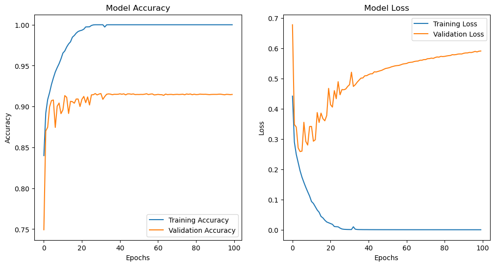

# Image Classification with a CNN

A TensorFlow/Keras study of ten-class, 28 × 28 grayscale image classification, from IDX data loading to convolutional training and evaluation.

[Explore the notebook](ImageClassificationWithCNN.ipynb) · [Read the report](Report-ImageClassificationWithCNN%20-%20Google%20Docs.pdf)

## Inside the experiment

The notebook builds a compact CNN with two convolutional stages (32 and 64 filters), batch normalization, max pooling, a 128-unit dense layer, and a ten-class softmax output. Inputs are normalized to `[0, 1]`, and 20% of the training data is reserved for validation with a fixed split seed.

Training is configured for 100 epochs with batches of 128, categorical cross-entropy, and momentum SGD. The notebook also plots training and validation accuracy and loss, evaluates a held-out test set, and saves the model as `fashion_mnist_model.keras`.

## Recorded result



*Original saved training plot from the committed notebook; not a new run.*

| Measure | Saved notebook output |
| --- | ---: |
| Test accuracy | 90.84% |
| Test loss | 0.6774 |

These are historical outputs stored in the notebook, not a freshly reproduced benchmark. The saved training log stops partway through epoch 5 even though the code requests 100 epochs; it does not establish the exact training history of the evaluated model.

## Open and run

1. Use a Python environment with Jupyter, NumPy, TensorFlow/Keras, Matplotlib, Seaborn, and scikit-learn. Dependency versions are not pinned in this repository.
2. Place these gzip-compressed IDX files beside the notebook:

   ```text
   train-images-idx3-ubyte.gz
   train-labels-idx1-ubyte.gz
   t10k-images-idx3-ubyte.gz
   t10k-labels-idx1-ubyte.gz
   ```

3. Open `ImageClassificationWithCNN.ipynb`, select that environment, and run the cells in order.

The data files are not included. The model filename indicates Fashion-MNIST, but the loader accepts MNIST-format IDX files without checking dataset identity. The reshapes require 60,000 training images and 10,000 test images, each 28 × 28 pixels, with ten classes.

## Reproduction notes

- The optimizer uses `tf.keras.optimizers.legacy.SGD`; use a compatible TensorFlow/Keras environment or update this call before running on a newer stack.
- An augmentation generator is defined, but the training call uses arrays directly, so the recorded training code does **not** apply that augmentation.
- Only the train/validation split is explicitly seeded; full training reproducibility is not configured.
- The saved model file is an output of running the notebook and is not included in the repository.

Documentation was checked against the committed notebook source and saved outputs. Training and evaluation were not rerun for this documentation update.
